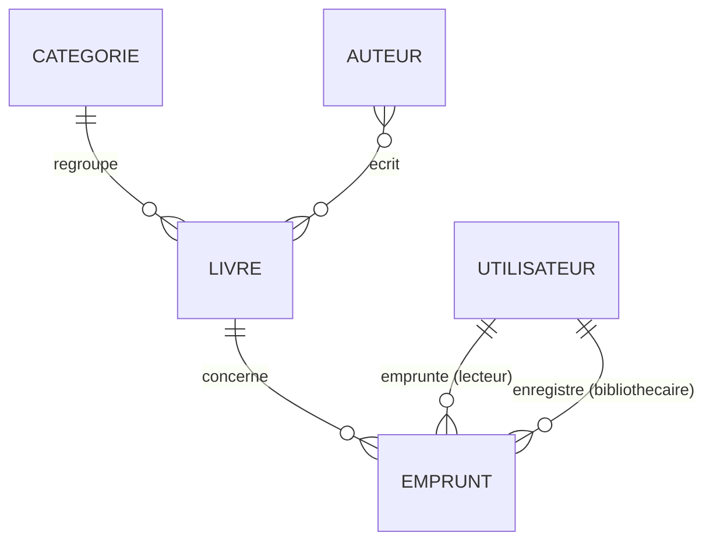

# API de gestion de bibliothèque

API REST de gestion d'une bibliothèque : catalogue de livres (auteurs, catégories), comptes utilisateurs avec rôles, et suivi des emprunts et des retours. L'accès est sécurisé par **JWT**.

Deux espaces distincts :

- **Bibliothécaire** : gère les livres, auteurs, catégories, enregistre les emprunts et les retours.
- **Lecteur** : s'inscrit lui-même, consulte les livres disponibles, voit ses emprunts, son historique et les dates de retour prévues. Il ne peut pas enregistrer un emprunt lui-même.

Un **administrateur** crée les comptes des bibliothécaires.

---

## Sommaire

1. [Technologies](#technologies)
2. [Architecture du projet](#architecture-du-projet)
3. [Modèle de données](#modèle-de-données)
4. [Règles métier](#règles-métier)
5. [Prérequis et installation](#prérequis-et-installation)
6. [Configuration](#configuration)
7. [Lancer l'application](#lancer-lapplication)
8. [Documentation Swagger](#documentation-swagger)
9. [Authentification et rôles](#authentification-et-rôles)
10. [Routes de l'API](#routes-de-lapi)
11. [Format des erreurs](#format-des-erreurs)
12. [Scénario de test rapide](#scénario-de-test-rapide)
13. [Limites connues](#limites-connues)
14. [Pistes d'amélioration](#pistes-damélioration)

---

## Technologies

| Outil | Rôle |
|---|---|
| Java 21 | Langage |
| Spring Boot 4.1.2 | Framework |
| Spring Data JPA / Hibernate | Accès aux données |
| PostgreSQL | Base de données |
| Spring Security + JWT (JJWT) | Authentification et autorisation |
| Bean Validation | Validation des données reçues |
| Lombok | Réduction du code répétitif |
| springdoc-openapi (Swagger UI) | Documentation interactive |
| Maven (wrapper `mvnw` inclus) | Gestion du build |

---

## Architecture du projet

Le projet suit une architecture en couches. Chaque couche a un rôle précis :

```
com.example.gestionDeBibliotheque
├── Model           Entités JPA (Utilisateur, Livre, Emprunt, Categorie, Auteur, Role)
├── Repository      Accès à la base de données (Spring Data JPA)
├── DTO             Objets d'échange avec le client (requêtes et réponses)
├── Mapper          Conversion entité <-> DTO
├── Service         Logique métier et règles de gestion
├── Controller      Points d'entrée HTTP (routes REST)
├── Exception       Exceptions personnalisées et gestionnaire global d'erreurs
├── Configuration   Configuration de la sécurité et de Swagger
└── Security        JWT, filtre d'authentification, chargement des utilisateurs
```

Principe : le **controller** reçoit la requête, le **service** applique les règles métier, le **repository** lit et écrit en base, le **mapper** traduit entre entités et DTO. Le client ne manipule jamais directement les entités (le mot de passe n'est ainsi jamais renvoyé).

---

## Modèle de données



| Relation | Type |
|---|---|
| Catégorie - Livre | 1 - N : une catégorie regroupe plusieurs livres |
| Auteur - Livre | N - N : un livre a un ou plusieurs auteurs (table `livre_auteur`) |
| Livre - Emprunt | 1 - N : un livre apparaît dans plusieurs emprunts au fil du temps |
| Utilisateur - Emprunt (lecteur) | 1 - N : un lecteur effectue plusieurs emprunts |
| Utilisateur - Emprunt (bibliothécaire) | 1 - N : un bibliothécaire enregistre plusieurs emprunts |

Les rôles sont une énumération Java : `LECTEUR`, `BIBLIOTHECAIRE`, `ADMIN`.

---

## Règles métier

1. L'email d'un utilisateur est **unique** (et **sensible à la casse** : `Madi@test.com` et `madi@test.com` sont deux comptes différents).
2. L'ISBN d'un livre est **unique**.
3. Le mot de passe est **haché** (BCrypt) : il n'est jamais stocké ni renvoyé en clair.
4. Le rôle est une énumération Java.
5. Un livre ne peut pas être emprunté si le nombre d'exemplaires disponibles est égal à zéro.
6. Un lecteur ne peut pas avoir **deux emprunts actifs du même livre**.
7. Chaque emprunt correspond à **un seul exemplaire** : le stock disponible diminue de 1 à l'emprunt et augmente de 1 au retour.
8. Le bibliothécaire est associé à chaque emprunt qu'il enregistre. Son identité vient du **token JWT**, jamais de la requête.
9. Un livre a **au moins un auteur** et appartient à **une catégorie**.
10. Une catégorie ou un auteur lié à des livres ne peut pas être supprimé. Un livre ayant des emprunts ne peut pas être supprimé.
11. Si le nombre total d'exemplaires d'un livre est modifié, le stock disponible est ajusté : le nouveau total ne peut pas être inférieur au nombre d'exemplaires actuellement empruntés.
12. Un retour ne peut être enregistré qu'une seule fois par emprunt.

### Durée de prêt selon le nombre de pages

La date de retour prévue dépend du nombre de pages du livre : plus il est volumineux, plus le lecteur dispose de temps.

| Nombre de pages | Durée de prêt |
|---|---|
| moins de 200 | 7 jours |
| de 200 à 399 | 14 jours |
| de 400 à 699 | 21 jours |
| 700 et plus | 28 jours |

Les seuils et les durées sont des constantes en haut de `EmpruntService`, faciles à modifier.

---

## Prérequis et installation

- **Java 21** (JDK)
- **PostgreSQL** (testé avec la version 18)
- Maven n'a pas besoin d'être installé : le wrapper `mvnw` est fourni.

1. Cloner le dépôt :

```bash
git clone <URL_DU_DEPOT>
cd gestionDeBibliotheque
```

2. Créer la base de données PostgreSQL :

```sql
CREATE DATABASE gestion_bibliotheque;
```

Les tables sont créées automatiquement par Hibernate au premier démarrage.

---

## Configuration

Le fichier `src/main/resources/application.properties` doit contenir :

```properties
spring.application.name=gestionDeBibliotheque
server.port=9000

# Base de données
spring.datasource.url=jdbc:postgresql://localhost:5432/gestion_bibliotheque
spring.datasource.username=postgres
spring.datasource.password=VOTRE_MOT_DE_PASSE_POSTGRES

# JPA
spring.jpa.hibernate.ddl-auto=update
spring.jpa.show-sql=true
spring.jpa.open-in-view=false

# Compte administrateur créé au premier démarrage
app.admin.email=admin@bibliotheque.local
app.admin.password=CHANGER_CE_MOT_DE_PASSE

# JWT
app.jwt.secret=UNE_CLE_SECRETE_D_AU_MOINS_32_CARACTERES
app.jwt.expiration-ms=86400000
```

| Propriété | Signification |
|---|---|
| `server.port` | Port d'écoute de l'API |
| `app.admin.email` / `app.admin.password` | Identifiants de l'administrateur créé automatiquement au démarrage (une seule fois) |
| `app.jwt.secret` | Clé qui signe les tokens. **Au moins 32 caractères**, à garder secrète |
| `app.jwt.expiration-ms` | Durée de vie d'un token en millisecondes (`86400000` = 24 heures) |

### Générer un secret JWT (PowerShell)

```powershell
$bytes = New-Object byte[] 48
$rng = [System.Security.Cryptography.RandomNumberGenerator]::Create()
$rng.GetBytes($bytes)
[Convert]::ToBase64String($bytes)
```

### Sécurité de la configuration

**Ne publiez jamais** vos vrais mots de passe ni votre secret JWT sur GitHub. Deux solutions :

- ajouter `src/main/resources/application.properties` au `.gitignore` et fournir un fichier `application.properties.example` avec des valeurs fictives ;
- ou utiliser des variables d'environnement :

```properties
spring.datasource.password=${DB_PASSWORD}
app.admin.password=${ADMIN_PASSWORD}
app.jwt.secret=${JWT_SECRET}
```

```powershell
$env:DB_PASSWORD="..."
$env:ADMIN_PASSWORD="..."
$env:JWT_SECRET="..."
```

---

## Lancer l'application

```bash
./mvnw spring-boot:run
```

Sous Windows PowerShell : `./mvnw spring-boot:run` (ou `mvnw.cmd spring-boot:run` en invite de commandes classique).

L'application est prête quand la console affiche :

```
Started GestionDeBibliothequeApplication in X seconds
```

Au premier démarrage, le compte administrateur défini dans `app.admin.*` est créé automatiquement s'il n'existe pas.

Pour compiler uniquement :

```bash
./mvnw compile
```

---

## Documentation Swagger

Une fois l'application lancée :

```
http://localhost:9000/swagger-ui/index.html
```

Pour tester les routes protégées dans Swagger :

1. Appeler `POST /auth/login` et copier la valeur de `token`.
2. Cliquer sur le bouton **Authorize** en haut de la page.
3. Coller le token **sans écrire `Bearer`**, puis valider.

Pour changer d'utilisateur : **Authorize**, **Logout**, puis coller le nouveau token.

La description au format JSON est disponible sur `http://localhost:9000/v3/api-docs`.

---

## Authentification et rôles

L'API est **stateless** : après connexion, le client reçoit un token JWT à envoyer à chaque requête :

```
Authorization: Bearer <token>
```

| Rôle | Peut faire |
|---|---|
| **Non connecté** | s'inscrire (`/auth/register`) et se connecter (`/auth/login`) |
| **LECTEUR** | consulter livres, catégories, auteurs ; voir **ses propres** emprunts |
| **BIBLIOTHECAIRE** | gérer livres, auteurs, catégories ; enregistrer emprunts et retours ; consulter tous les emprunts |
| **ADMIN** | créer des comptes de bibliothécaires |

Création des comptes :

- L'inscription publique crée **toujours** un `LECTEUR` (le rôle ne peut pas être choisi par le client).
- Les bibliothécaires sont créés par l'**ADMIN** via `POST /utilisateurs/bibliothecaires`.
- Aucun endpoint ne permet de créer un ADMIN : le premier est créé au démarrage à partir de `app.admin.*`.

Codes de sécurité :

- **401** : token absent, invalide ou expiré.
- **403** : token valide, mais rôle insuffisant pour cette route.

---

## Routes de l'API

### Authentification

| Méthode | Route | Accès | Description |
|---|---|---|---|
| POST | `/auth/register` | public | Inscription d'un lecteur |
| POST | `/auth/login` | public | Connexion, renvoie le token JWT |

### Utilisateurs

| Méthode | Route | Accès | Description |
|---|---|---|---|
| POST | `/utilisateurs/bibliothecaires` | ADMIN | Créer un compte bibliothécaire |

### Catégories

| Méthode | Route | Accès | Description |
|---|---|---|---|
| GET | `/categories` | LECTEUR, BIBLIOTHECAIRE | Lister les catégories |
| GET | `/categories/{id}` | LECTEUR, BIBLIOTHECAIRE | Détail d'une catégorie |
| POST | `/categories` | BIBLIOTHECAIRE | Créer une catégorie |
| PUT | `/categories/{id}` | BIBLIOTHECAIRE | Modifier une catégorie |
| DELETE | `/categories/{id}` | BIBLIOTHECAIRE | Supprimer une catégorie (si aucun livre ne l'utilise) |

### Auteurs

| Méthode | Route | Accès | Description |
|---|---|---|---|
| GET | `/auteurs` | LECTEUR, BIBLIOTHECAIRE | Lister les auteurs |
| GET | `/auteurs/{id}` | LECTEUR, BIBLIOTHECAIRE | Détail d'un auteur |
| POST | `/auteurs` | BIBLIOTHECAIRE | Créer un auteur |
| PUT | `/auteurs/{id}` | BIBLIOTHECAIRE | Modifier un auteur |
| DELETE | `/auteurs/{id}` | BIBLIOTHECAIRE | Supprimer un auteur (s'il n'a aucun livre) |

### Livres

| Méthode | Route | Accès | Description |
|---|---|---|---|
| GET | `/livres` | LECTEUR, BIBLIOTHECAIRE | Lister tous les livres |
| GET | `/livres/disponibles` | LECTEUR, BIBLIOTHECAIRE | Lister les livres ayant au moins un exemplaire disponible |
| GET | `/livres/{id}` | LECTEUR, BIBLIOTHECAIRE | Détail d'un livre |
| POST | `/livres` | BIBLIOTHECAIRE | Créer un livre |
| PUT | `/livres/{id}` | BIBLIOTHECAIRE | Modifier un livre (le stock est ajusté) |
| DELETE | `/livres/{id}` | BIBLIOTHECAIRE | Supprimer un livre (s'il n'a aucun emprunt) |

### Emprunts

| Méthode | Route | Accès | Description |
|---|---|---|---|
| POST | `/emprunts` | BIBLIOTHECAIRE | Enregistrer un emprunt |
| PUT | `/emprunts/{id}/retour` | BIBLIOTHECAIRE | Enregistrer le retour d'un livre |
| GET | `/emprunts` | BIBLIOTHECAIRE | Tous les emprunts |
| GET | `/emprunts/en-cours` | BIBLIOTHECAIRE | Emprunts dont le livre n'est pas encore rendu |
| GET | `/emprunts/lecteur/{lecteurId}` | BIBLIOTHECAIRE | Emprunts d'un lecteur donné |
| GET | `/emprunts/mes-emprunts` | LECTEUR | Historique du lecteur connecté |

### Exemples de corps de requête

**Inscription** (`POST /auth/register`) :

```json
{
  "name": "Madi",
  "email": "madi@test.com",
  "password": "motdepasse123"
}
```

**Connexion** (`POST /auth/login`) :

```json
{
  "email": "madi@test.com",
  "password": "motdepasse123"
}
```

Réponse :

```json
{
  "token": "eyJhbGciOiJIUzUxMiJ9...",
  "type": "Bearer"
}
```

**Création d'un livre** (`POST /livres`) :

```json
{
  "titre": "Les Misérables",
  "isbn": "9782070409228",
  "nombrePages": 1900,
  "nombreExemplaires": 3,
  "categorieId": 1,
  "auteurIds": [1]
}
```

**Création d'un emprunt** (`POST /emprunts`) :

```json
{
  "lecteurId": 2,
  "livreId": 1
}
```

Réponse :

```json
{
  "id": 1,
  "dateEmprunt": "2026-11-17",
  "dateRetourPrevue": "2026-12-15",
  "dateRetourEffective": null,
  "lecteurId": 2,
  "lecteurNom": "Madi",
  "bibliothecaireId": 3,
  "bibliothecaireNom": "Biblio Un",
  "livreId": 1,
  "livreTitre": "Les Misérables"
}
```

---

## Format des erreurs

Toutes les erreurs ont la même forme :

```json
{
  "status": 409,
  "message": "Ce lecteur a déjà un emprunt actif de ce livre",
  "timestamp": "2026-11-17T09:29:19.178"
}
```

Pour les erreurs de validation, le détail par champ est ajouté :

```json
{
  "status": 400,
  "message": "Données invalides",
  "erreurs": {
    "auteurIds": "Un livre doit avoir au moins un auteur"
  },
  "timestamp": "2026-11-17T09:29:19.178"
}
```

| Code | Signification |
|---|---|
| 200 | Succès |
| 201 | Ressource créée |
| 204 | Suppression réussie (pas de contenu) |
| 400 | Données invalides (champ manquant, format incorrect) |
| 401 | Non authentifié (token absent, invalide, expiré, ou mauvais identifiants) |
| 403 | Authentifié mais droits insuffisants |
| 404 | Ressource introuvable |
| 409 | Conflit avec une règle métier (doublon, stock à zéro, retour déjà fait...) |
| 500 | Erreur interne (le détail est écrit dans la console du serveur) |

---

## Scénario de test rapide

À faire dans Swagger ou Postman, dans cet ordre :

1. **Connexion admin** : `POST /auth/login` avec les identifiants `app.admin.*`, puis utiliser le token.
2. **Créer un bibliothécaire** : `POST /utilisateurs/bibliothecaires`, résultat attendu : **201**.
3. **Se connecter en bibliothécaire**, puis utiliser son token.
4. **Créer une catégorie**, **un auteur**, puis **un livre** (avec les identifiants renvoyés).
5. **S'inscrire comme lecteur** : `POST /auth/register`, noter son `id`.
6. **Emprunter** : `POST /emprunts` : **201**, le stock du livre diminue de 1.
7. **Refaire le même emprunt** : **409** (emprunt déjà actif).
8. **Enregistrer le retour** : `PUT /emprunts/{id}/retour` : **200**, le stock remonte.
9. **Refaire le retour** : **409**.
10. **Se connecter en lecteur** : `GET /emprunts/mes-emprunts` : **200** (uniquement ses emprunts).
11. **En lecteur**, `POST /livres` : **403**.
12. **Sans token**, `GET /livres` : **401**.

---

## Limites connues

- **Concurrence sur le stock** : si deux bibliothécaires empruntent le dernier exemplaire exactement au même moment, le stock pourrait devenir négatif. Un verrou pessimiste sur la ligne du livre corrigerait ce cas.
- **Emails sensibles à la casse** : `Madi@test.com` et `madi@test.com` sont deux comptes distincts, et la connexion exige la même casse qu'à l'inscription.
- **Pas de pagination** : les routes de liste renvoient tous les éléments.
- **Pas de réinitialisation de mot de passe** ni de gestion des comptes (liste, désactivation).
- **`ddl-auto=update`** est pratique en développement ; pour un déploiement réel, on utiliserait des migrations (Flyway ou Liquibase).
- Les tokens ne sont pas révocables avant leur expiration (24 heures par défaut).
- La classe de test générée par Spring démarre toute l'application : elle nécessite PostgreSQL et les propriétés `app.*`.

---

## Pistes d'amélioration

- Pagination et recherche (par titre, auteur, catégorie).
- Liste des emprunts en retard (livre non rendu et date prévue dépassée).
- Tests unitaires de `EmpruntService` (stock à zéro, doublon, retour en double).
- Gestion des utilisateurs : liste, désactivation, changement de mot de passe.
- Configuration CORS si un front-end sur un autre domaine appelle l'API.
- Migrations de base de données avec Flyway.

---

## Auteur

Projet réalisé par **[Ton nom]**.